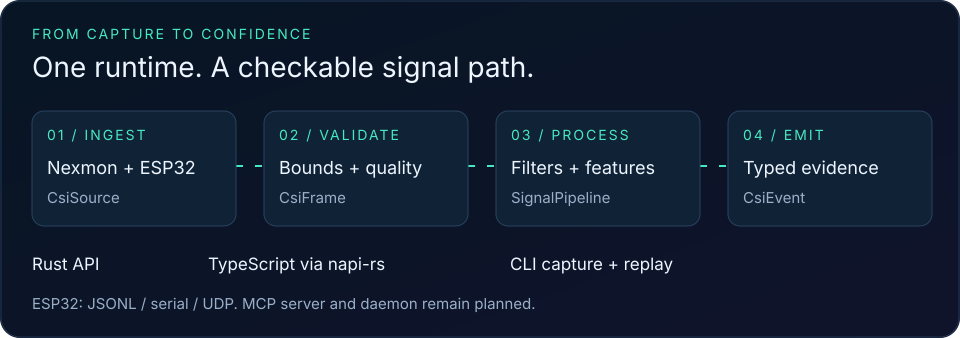

# 📡 rvCSI — edge RF sensing runtime

[](#quickstart-cli)

> **Turn WiFi Channel State Information into validated, typed, confidence-scored RF events — in Rust, from TypeScript, from the CLI.**

[](https://www.rust-lang.org/)
[](#license)
[](#testing)
[](https://crates.io/crates/rvcsi-core)
[](https://www.npmjs.com/package/@ruv/rvcsi)

rvCSI is the **stable, hardware-abstracted runtime layer** that real CSI pipelines are missing. Today, WiFi sensing is shell scripts, patched firmware, kernel modules, Python notebooks, PCAP dumps and ad-hoc DSP — formats differ per chip, drivers are unstable, malformed packets are common, device assumptions leak everywhere. rvCSI fixes that:

- **Ingests** CSI from many sources behind one trait (`CsiSource`) — Nexmon (BCM43455c0 / Raspberry Pi 4 & **5**, 4358, 4366c0), ESP32, Intel, Atheros, `.rvcsi` capture files, deterministic replay.
- **Validates** every packet in Rust *before* it can touch application code — length/finiteness/profile checks, plausibility bounds, structured errors, never panics, never raw pointers across a language boundary.
- **Normalizes** everything into one schema — `CsiFrame` → `CsiWindow` → `CsiEvent`.
- **Processes** with reusable DSP — Hampel/MAD outlier filter, phase unwrap, smoothing, sliding variance, DC removal, baseline subtraction, motion energy, presence, heuristic breathing-band estimate.
- **Emits** typed events with confidence + evidence — presence started/ended, motion detected/settled, baseline drift, anomaly, signal-quality drop, calibration-required, breathing candidate.
- **Bridges** to [RuVector](https://github.com/ruvnet/ruvector) as RF memory — deterministic window/event embeddings, similarity search, drift detection.
- **Exposes** a Rust API, a TypeScript SDK ([`@ruv/rvcsi`](https://www.npmjs.com/package/@ruv/rvcsi), napi-rs), and a CLI (`rvcsi`).

> rvCSI is *structural sensing*: excellent at detecting change, presence, motion, drift, and learned patterns — deliberately silent on exact identity, exact pose, and medical-grade certainty. **Detection ≠ decision** — rvCSI emits evidence; agents and applications decide what to do.

The architecture is set by **[ADR-095](docs/adr/ADR-095-rvcsi-edge-rf-sensing-platform.md)** (the 15 platform decisions: Rust core, C-only-at-the-hardware-boundary, TS SDK via napi-rs, normalized schema, validate-before-FFI, CSI-as-temporal-delta, RuVector as RF memory, replayability, detection≠decision, local-first, read-first/write-gated MCP, mandatory quality scoring, versioned calibration, plugin adapters) and **[ADR-096](docs/adr/ADR-096-rvcsi-ffi-crate-layout.md)** (the crate topology, the napi-c shim contract, the napi-rs surface). See the [PRD](docs/prd/rvcsi-platform-prd.md) for requirements and the [domain model](docs/ddd/rvcsi-domain-model.md) for the 7 bounded contexts.

---

## Crates



| Crate | `unsafe`? | What it owns |
|-------|-----------|--------------|
| [`rvcsi-core`](crates/rvcsi-core) | no (`forbid`) | The normalized `CsiFrame`/`CsiWindow`/`CsiEvent` schema, `AdapterProfile`, the `CsiSource` plugin trait, id newtypes + `IdGenerator`, `RvcsiError`, the `validate_frame` pipeline + quality scoring. The shared kernel. |
| [`rvcsi-dsp`](crates/rvcsi-dsp) | no (`forbid`) | Pure DSP primitives (`mean`/`variance`/`median`, `remove_dc_offset`, `unwrap_phase`, `moving_average`, `ewma`, `hampel_filter`, `short_window_variance`, `subtract_baseline`), scalar features (`motion_energy`, `presence_score`, `confidence_score`, heuristic `breathing_band_estimate`), and a non-destructive `SignalPipeline::process_frame`. |
| [`rvcsi-events`](crates/rvcsi-events) | no (`forbid`) | `WindowBuffer` (frames → `CsiWindow`), the `EventDetector` trait + presence/motion/quality/baseline-drift state machines (drift thresholds are **scale-relative** — a fraction of the baseline magnitude — so one tuning works across `int8` ESP32, `int16`-scaled Nexmon, and baseline-subtracted streams), and `EventPipeline`. |
| [`rvcsi-adapter-esp32`](crates/rvcsi-adapter-esp32) | no (`forbid`) | Bounded collector JSONL, serial and UDP capture; signed I/Q decoding; `CsiSource` integration. |
| [`rvcsi-adapter-file`](crates/rvcsi-adapter-file) | no (`forbid`) | The `.rvcsi` capture container (JSONL: a header line + one `CsiFrame` per line), `FileRecorder`, `FileReplayAdapter` — deterministic replay. |
| [`rvcsi-adapter-nexmon`](crates/rvcsi-adapter-nexmon) | **yes** (FFI only) | The **napi-c** seam: `native/rvcsi_nexmon_shim.{c,h}` (the only C in the runtime — allocation-free, bounds-checked, ABI `1.1`) compiled via `build.rs`+`cc`, handling the rvCSI Nexmon record **and** the real nexmon_csi UDP payload (18-byte header + `int16` I/Q) + a Broadcom d11ac **chanspec decoder**; a pure-Rust **libpcap reader**; a **Nexmon-chip / Raspberry-Pi-model registry** (incl. **Pi 5 → BCM43455c0**); `NexmonAdapter` + `NexmonPcapAdapter` `CsiSource`s. |
| [`rvcsi-ruvector`](crates/rvcsi-ruvector) | no (`forbid`) | The RuVector RF-memory bridge: deterministic `window_embedding`/`event_embedding`, `cosine_similarity`, the `RfMemoryStore` trait, `InMemoryRfMemory` + `JsonlRfMemory` (standins until the production RuVector binding lands). |
| [`rvcsi-runtime`](crates/rvcsi-runtime) | no (`forbid`) | The no-FFI composition layer: `CaptureRuntime` = `CsiSource` + `validate_frame` + `SignalPipeline` + `EventPipeline`, plus one-shot helpers (`summarize_capture`, `decode_nexmon_records`, `decode_nexmon_pcap`, `summarize_nexmon_pcap`, `events_from_capture`, `export_capture_to_rf_memory`). The shared layer under `rvcsi-node` and `rvcsi-cli`. |
| [`rvcsi-node`](crates/rvcsi-node) | no (`deny(clippy::all)`) | The **napi-rs** seam — the `.node` addon (cdylib + rlib) exposing a safe TS-facing surface (thin `#[napi]` wrappers over `rvcsi-runtime`); ships as the [`@ruv/rvcsi`](https://www.npmjs.com/package/@ruv/rvcsi) npm package. |
| [`rvcsi-cli`](crates/rvcsi-cli) | no | The `rvcsi` binary: `record`, `inspect`, `inspect-nexmon`, `nexmon-chips`, `decode-chanspec`, `replay`, `stream`, `events`, `health`, `calibrate`, `export ruvector`. |

`rvcsi-mcp` (an MCP tool server), `rvcsi-daemon` (live radio capture + WebSocket), and the legacy nexmon *packed-float* CSI export are tracked as follow-ups on top of these crates.

---

## RF memory

[](crates/rvcsi-ruvector)

The current RF memory bridge provides deterministic embeddings and in-memory or JSONL storage. The production RuVector binding remains a follow-up. See the [RF memory crate](crates/rvcsi-ruvector) for details.

## Install

### Rust

```bash
# the CLI
cargo install rvcsi-cli      # installs the `rvcsi` binary

# or a library, in Cargo.toml
[dependencies]
rvcsi-core    = "0.4"
rvcsi-dsp     = "0.4"
rvcsi-events  = "0.4"
rvcsi-runtime = "0.4"        # the composition layer most apps want
```

### Node / TypeScript

```bash
npm install @ruv/rvcsi
```

```ts
import { inspectCaptureFile, eventsFromCaptureFile, RvcsiRuntime } from "@ruv/rvcsi";

console.log(inspectCaptureFile("session.rvcsi"));        // frame count, channels, quality, ...
for (const ev of eventsFromCaptureFile("session.rvcsi")) // presence/motion/anomaly/...
  console.log(ev.kind, ev.confidence, ev.timestampNs);

const rt = RvcsiRuntime.openCaptureFile("session.rvcsi");
let f; while ((f = rt.nextCleanFrameJson()) !== null) { /* validated + DSP-cleaned */ }
```

---

## Quickstart (CLI)

```bash
# Capture real nexmon_csi on a Raspberry Pi:
tcpdump -i wlan0 dst port 5500 -w csi.pcap

# Transcode to a validated .rvcsi capture (Pi 5 / BCM43455c0 profile):
rvcsi record --source nexmon-pcap --in csi.pcap --out session.rvcsi --chip pi5

# Inspect it:
rvcsi inspect session.rvcsi
#   frames : 12048   channels : [36]   subcarriers : [256]   mean quality : 0.91
#   validation : accepted=12001 degraded=47 rejected=0 ...

# Run the DSP + event pipeline:
rvcsi events session.rvcsi
#   1700000000000000000 ns  presence_started   conf=0.94  evidence=[7]
#   1700000003000000000 ns  motion_detected    conf=0.81  evidence=[10]
#   1700000061000000000 ns  baseline_changed   conf=0.62  evidence=[31]

# Learn a v0 baseline, decode a chanspec, list known Nexmon chips:
rvcsi calibrate --in session.rvcsi --out baseline.json
rvcsi decode-chanspec 0xe024
rvcsi nexmon-chips
```

### ESP32: native file, serial and UDP capture

The [`rvcsi-adapter-esp32`](crates/rvcsi-adapter-esp32) crate now implements `CsiSource` for collector JSONL, native serial and UDP. Build this checkout for the new commands; registry publication is separate.

```bash
cargo build --release -p rvcsi-cli
./target/release/rvcsi record --source esp32-jsonl --in session.csi.jsonl --out session.rvcsi
./target/release/rvcsi record --source esp32-serial --in /dev/ttyUSB0 --baud 115200 --limit 1000 --out serial.rvcsi
./target/release/rvcsi record --source esp32-udp --in 127.0.0.1:5501 --limit 1000 --out udp.rvcsi
./target/release/rvcsi inspect session.rvcsi --json
./target/release/rvcsi events session.rvcsi --json
./target/release/rvcsi calibrate --in session.rvcsi --out baseline.json
```

Firmware or a collector must emit the documented `raw_csi` JSON contract, not arbitrary ESP-IDF CSV. Live capture requires a frame limit; receive timeout defaults to 5 seconds. Failed captures are not published, and existing outputs are never overwritten. UDP is unauthenticated: bind explicitly and restrict senders. See the [adapter guide](crates/rvcsi-adapter-esp32) and [ADR-097](docs/adr/ADR-097-esp32-source-adapter.md). A [measured ESP32-C6 verification](docs/verification/esp32-c6-2026-10-12.md) covers real binary UDP through a collector into this adapter; direct JSON serial and other boards remain unqualified.

---

## Claude plugin

This repo ships a [Claude Code](https://claude.com/claude-code) plugin marketplace ([`.claude-plugin/marketplace.json`](.claude-plugin/marketplace.json)) with an **`rvcsi`** plugin: slash commands for capturing/inspecting/replaying CSI and running the event pipeline, plus an agent that knows the schema, the validation rules, and the adapter contract.

```
/plugin marketplace add ruvnet/rvcsi
/plugin install rvcsi@rvcsi
```

Then: `/rvcsi-inspect <file.rvcsi>`, `/rvcsi-events <file.rvcsi>`, `/rvcsi-record …`, `/rvcsi-nexmon …`. See [`plugins/rvcsi/README.md`](plugins/rvcsi/README.md).

---

## Build & test

```bash
cargo build --workspace
cargo test  --workspace          # 170 tests, 0 failures
cargo clippy --workspace         # clippy-clean
```

`#![forbid(unsafe_code)]` in every crate except `rvcsi-adapter-nexmon`, where `unsafe` is confined to one `ffi` module wrapping the C shim — every block carries a `// SAFETY:` comment. The C shim is allocation-free, bounds-checked, ABI-versioned, and never panics.

`rvcsi-node` is a workspace member (a napi cdylib links fine with Node symbols left undefined on Linux/macOS), so `cargo build`/`cargo test` work without a Node toolchain — only `napi build` (the npm prebuild) needs Node.

---

## Provenance

rvCSI was extracted from the [RuView / WiFi-DensePose](https://github.com/ruvnet/RuView) project (ADR-095, ADR-096) where it was incubated; RuView consumes it back as a `vendor/rvcsi` submodule.

## License

Licensed under either of [Apache License, Version 2.0](LICENSE-APACHE) or [MIT license](LICENSE-MIT) at your option. Unless you explicitly state otherwise, any contribution intentionally submitted for inclusion in the work by you, as defined in the Apache-2.0 license, shall be dual licensed as above, without any additional terms or conditions.
